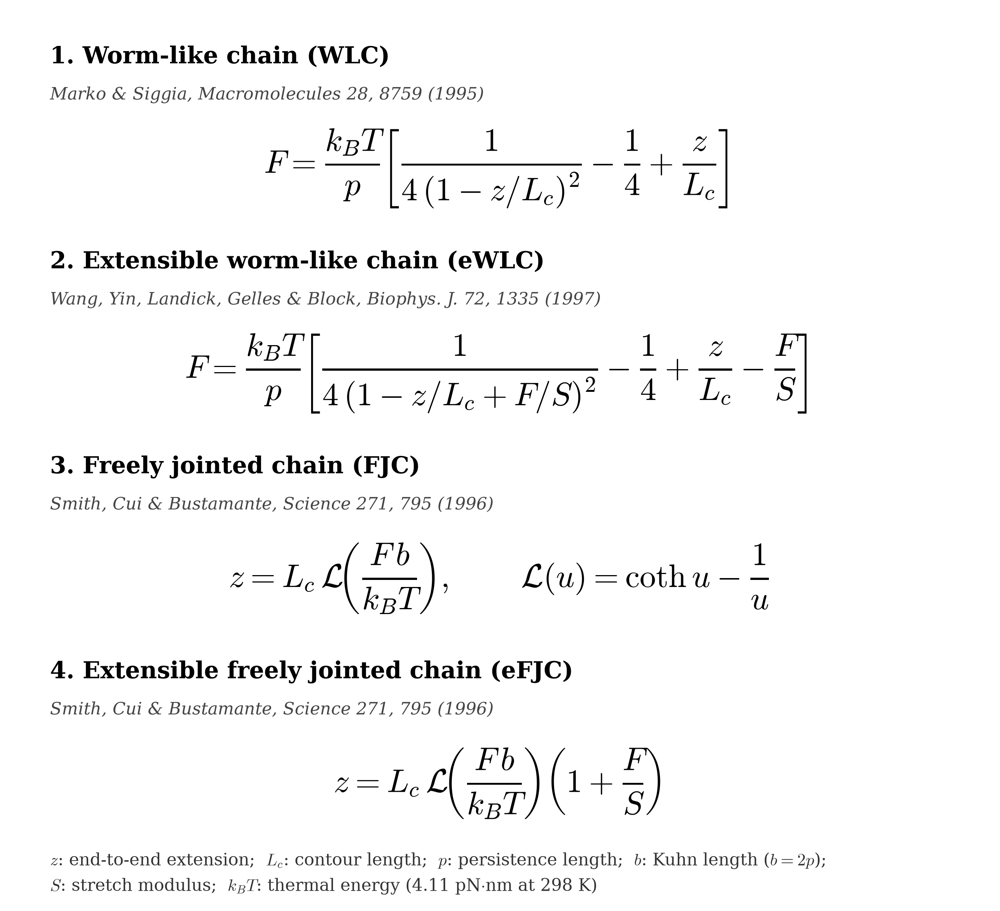
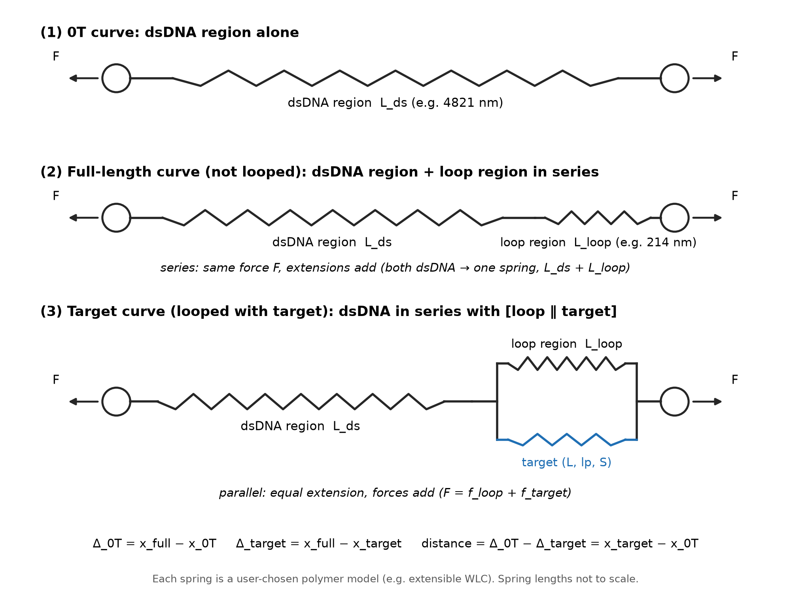
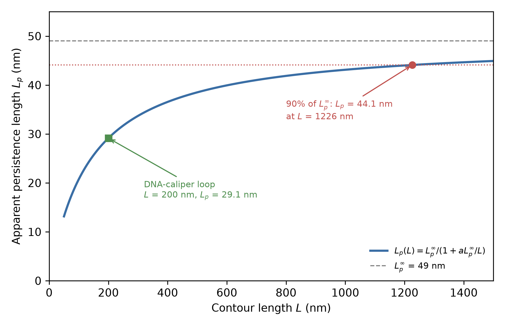

# DNA force-extension toolkit: model guide

This note is a write-up guide for the DNA force-extension toolkit proposed in [issue #32](https://github.com/andyrward/Optical_Trap_Calibration/issues/32) of the `andyrward/Optical_Trap_Calibration` repository. The Python module `optical_trap_dna.py` is under review in [pull request #33](https://github.com/andyrward/Optical_Trap_Calibration/pull/33) on the branch `copilot/add-dna-force-extension-toolkit` and has not been merged. The module accepts the model keywords `wlc`, `extensible_wlc`, `fjc`, and `extensible_fjc`. The four force-extension equations used by the toolkit are collected in Figure 1, together with model names, citations, and a symbol key. The Kuhn length is $b = 2p$, and $k_BT = 4.11$ pN·nm at 298 K.

*Figure 1. Force-extension equations for the worm-like chain (Marko and Siggia 1995), the extensible worm-like chain in the inverted Wang form (Wang, Yin, Landick, Gelles, and Block 1997), the freely jointed chain, and the extensible freely jointed chain in the multiplicative Smith form (Smith, Cui, and Bustamante 1996), with a symbol key. The Kuhn length is $b = 2p$, and $k_BT = 4.11$ pN·nm at 298 K.*

## When to use each model

The worm-like chain (WLC; keyword `wlc`) is the usual model for dsDNA at moderate force, roughly below 5–10 pN. The interpolating Marko–Siggia formula gives force as a function of extension, and the toolkit inverts it numerically to give $z(F)$. Camunas-Soler, Ribezzi-Crivellari, and Ritort (2016) place the low-force regime for dsDNA, in which scaling deviations from the WLC can appear, below about 0.04 pN, a range that is difficult to reach in an optical trap.

The extensible worm-like chain (eWLC; keyword `extensible_wlc`) is the usual model for dsDNA at higher force, up to just below the overstretching transition near 65 pN. Backbone stretch becomes measurable in this range, and the inverted Wang form in Figure 1 accounts for it by substituting $z/L_c \to z/L_c - F/S$ inside the Marko–Siggia bracket.

The freely jointed chain (FJC; keyword `fjc`) is the usual model for ssDNA at low force. Because the ssDNA persistence length is comparable to the interbase distance, the FJC is a better starting point than the WLC. Smith, Cui, and Bustamante (1996) found that an inextensible FJC describes ssDNA up to about 10 pN. The Camunas-Soler review places the low-force scaling regime for ssDNA and RNA at forces up to about 4 pN.

The extensible freely jointed chain (eFJC; keyword `extensible_fjc`) is the usual model for ssDNA above about 10 pN, where stretch of the phosphodiester backbone becomes measurable. Figure 1 shows the multiplicative form printed by Smith, Cui, and Bustamante (1996), $z = L_c\,\mathcal{L}(Fb/k_BT)\,(1+F/S)$, where $\mathcal{L}(u) = \coth u - 1/u$ is the Langevin function.

**Recommended persistence length for the caliper’s short ssDNA arms.** For the short ssDNA arms in the DNA-caliper construct, we recommend a persistence length of $L_p$ = 1.0–1.5 nm, used with the WLC model (keyword `wlc`), at typical assay salt of about 150 mM. This range covers two short-ssDNA entries in Table 1 of Camunas-Soler, Ribezzi-Crivellari, and Ritort (2016). The first is the WLC fit to about 20-base hairpins at 1 M NaCl, which gives $L_p = 1.35$ nm and 0.58 nm/base. The second is the dynamic force spectroscopy (DFS) fit to about 20-base hairpins at 0.2 M NaCl, which gives $L_p$ = 1.0–1.5 nm. The review reports that short ssDNA of 10–70 bases is stiffer than long ssDNA, with $L_p$ rising from 0.7 nm for several kilobases to 1.1–1.3 nm for a few tens of bases, so the toolkit’s 0.75 nm FJC default is better suited to long ssDNA than to the caliper arms. These values are salt-dependent, and 150 mM sits below the 1 M entries and also below the 0.2 M entry, so the review has no short-ssDNA value measured at assay salt. The recommended range is therefore an informed choice rather than a measured value for these conditions, and Table 1 does not state the temperature of any entry.

## Construct curves

The toolkit builds three construct curves from these segment models, as shown in Figure 2. The 0T curve is the dsDNA region alone. The full-length curve is the dsDNA region in series with the loop region. The Target curve is the dsDNA region in series with a block in which the loop and the target sit in parallel, so they share one extension and the force splits between them. Segments in series carry the same force and their extensions add. The delta extensions are $\Delta_{0T} = x_{\mathrm{full}} - x_{0T}$ and $\Delta_{\mathrm{target}} = x_{\mathrm{full}} - x_{\mathrm{target}}$, and the distance estimate is $\Delta_{0T} - \Delta_{\mathrm{target}} = x_{\mathrm{target}} - x_{0T}$.

*Figure 2. Spring schematic of the DNA force-extension toolkit models from issue #32: the 0T curve (dsDNA region alone), the full-length curve (dsDNA region in series with the loop), and the Target curve (dsDNA region in series with the loop and target in parallel), with the delta-extension and distance equations below.*

The loop and target segments in a DNA-caliper construct, and short tether arms, can be short enough that the apparent persistence length drops. The 13,250 bp full-length dsDNA construct is long enough that a 50 nm persistence length remains reasonable, as discussed below.

## Parameter values

Most of the numerical values below are those quoted by Camunas-Soler, Ribezzi-Crivellari, and Ritort, *Annu. Rev. Biophys.* 45:65–84 (2016), from earlier work. The review refers to “standard conditions” but never defines them by salt concentration or temperature. Where a primary source is named, it is given in the table.

| Parameter | dsDNA | ssDNA | Source and conditions, as quoted in the review |
|---|---|---|---|
| Persistence length $L_p$ | 50 nm (45–55 nm for several-kb molecules; about 30 nm for a few hundred bp; $L_p^\infty = 49 \pm 2$ nm) | About 1 nm in the review’s summary; intrinsic 0.7 nm at high force; 0.76 nm at 1 M NaCl; 0.69 nm at 3 M NaCl and $F < 5$ pN (glyoxal denaturation); 1.0–1.6 nm for short oligos | dsDNA: Smith et al. 1996, eWLC, no salt or force range stated in the review; length dependence from Seol et al. 2007 and related work. ssDNA: Bosco, Camunas-Soler, and Ritort 2014, and Table 1 of the review |
| Kuhn length $b$ | $b = 2L_p$ | 1.5 nm; 1.55 nm (oligo method) | Smith et al. 1996 at 0.15 M NaCl; oligo method at 0.1 M NaCl |
| Contour length per base | 0.34 nm/bp is used by the toolkit (**[citation needed]**; not given in the review) | 0.57 nm/nt in FJC fits at 0.1–0.15 M NaCl; 0.58–0.70 nm/nt in WLC fits at 0.2–1 M | ssDNA values from Table 1 of the review |
| Stretch modulus $S$ | 1000 pN | 800 pN; 630 pN (oligo method) | Smith et al. 1996 at 0.15 M NaCl for the 1000 pN and 800 pN values; oligo method at 0.1 M NaCl for 630 pN |

The toolkit’s current defaults in `optical_trap_dna.py` are close to, but not identical with, these quoted values. For dsDNA they are a rise of 0.34 nm/bp, $L_p = 50$ nm, $S = 1200$ pN, and model `wlc`. For ssDNA they are a rise of 0.63 nm/nt, $L_p = 0.75$ nm, $S = 800$ pN, and model `fjc`. The 1200 pN dsDNA stretch modulus differs from the 1000 pN value quoted from Smith et al. 1996; the 0.63 nm/nt ssDNA rise sits inside the 0.58–0.70 nm/nt WLC range in Table 1 of the review.

## Length-dependent persistence length

The apparent dsDNA persistence length drops for short constructs. That caveat matters for the toolkit’s DNA-caliper loop and target segments and for short tether arms, whereas the 13,250 bp full-length construct is long enough that 50 nm is a reasonable choice. Andrew’s current fits fix $L_p$ at 50 nm for dsDNA, with the contour length fixed from the known sequence length and only the offset left free.

The review quotes the phenomenological finite-size formula

$$L_p(L) = \frac{L_p^\infty}{1 + a\,L_p^\infty/L},$$

with $L_p^\infty = 49 \pm 2$ nm. The constant $a$ is of order 1 and depends on the boundary conditions: $a = 2.78 \pm 0.12$ in single-trap studies (Chen et al. 2009; Seol et al. 2007) and $a = 4 \pm 2$ in double-trap studies (Ribezzi-Crivellari and Ritort 2012). The review prints the unit “nm” on the double-trap value of $a$, even though it describes $a$ as a dimensionless constant of order 1.

A short worked example uses $L_p^\infty = 49$ nm, the single-trap value $a = 2.78$, and the toolkit rise of 0.34 nm/bp. A 300 bp segment has contour length $L = 102.0$ nm and $L_p = 21.0$ nm. A 500 bp segment, still a few hundred base pairs, has $L = 170.0$ nm and $L_p = 27.2$ nm, close to the review’s figure of about 30 nm for molecules of that length. The 13,250 bp full-length construct has $L = 4505$ nm and $L_p = 47.6$ nm, which is close enough to 50 nm that fixing $L_p$ at 50 nm is reasonable for that arm. A 200 nm DNA-caliper loop (about 588 bp at 0.34 nm/bp) has $L_p = 29.1$ nm, about 59% of $L_p^\infty$.

Figure 3 plots the same formula over contour lengths from 50 nm to 1500 nm. The apparent persistence length reaches 90% of $L_p^\infty$ (44.1 nm) only at $L = a\,L_p^\infty/(1/0.9 - 1) \approx 1226$ nm, or about 3600 bp, so every segment shorter than that should be treated as short for this purpose. The 200 nm loop sits well below that crossing.

*Figure 3. Apparent dsDNA persistence length versus contour length from the finite-size formula $L_p(L) = L_p^\infty/(1 + a\,L_p^\infty/L)$, with $L_p^\infty = 49$ nm and the single-trap value $a = 2.78$ (Chen et al. 2009; Seol et al. 2007). The dashed line marks $L_p^\infty$, the dotted line and red point mark the 90% crossing ($L_p = 44.1$ nm at $L \approx 1226$ nm), and the green square marks a 200 nm DNA-caliper loop ($L_p = 29.1$ nm). The figure is generated by `draw_Lp_finite_size.py`.*

## Rise per base pair

The toolkit uses 0.34 nm/bp for dsDNA contour lengths. That rise is not given in the Camunas-Soler review, so a primary citation still needs to be added. **[citation needed]**

## Other useful values

The same review collects several other numbers that are useful when choosing a model or reading a force-extension curve. Overstretching of dsDNA occurs at about 65 pN (Smith et al. 1996). ssDNA forms secondary structure below about 10 pN, so FJC or eFJC fits in that range can be contaminated unless secondary structure is suppressed. Divalent cations act like monovalent cations at about 100 times lower concentration (Bosco, Camunas-Soler, and Ritort 2014). Linker or handle compliance is on the order of 1 pN/nm (Forns et al. 2011) and can matter for short constructs. Finally, dsDNA already reaches 30% relative extension at under 0.1 pN, whereas ssDNA reaches the same relative extension only at about 5 pN, which is why the two polymers look so different in an ordinary optical-trap force window.

## Stretch-term forms

Two ways of adding backbone stretch to the WLC are in common use. The additive form is

$$z = z_{\mathrm{WLC}}(F) + L_c F/S.$$

That expression is equivalent to Wang’s inverted substitution $z/L_c \to z/L_c - F/S$ inside the Marko–Siggia bracket, which is the eWLC printed in Figure 1. The same additive stretch term appears in Odijk’s high-force approximation, $x = L_c\bigl[1 - \tfrac{1}{2}\sqrt{k_BT/(Fp)} + F/S\bigr]$, which replaces $z_{\mathrm{WLC}}(F)$ by its high-force limit rather than by the inverted Marko–Siggia formula. The multiplicative form is

$$z = z_{\mathrm{WLC}}(F)\,(1 + F/S),$$

or equivalently $L \to L(1+F/S)$. That is how Camunas-Soler, Ribezzi-Crivellari, and Ritort (2016) describe the eWLC in words, and it is how Smith, Cui, and Bustamante (1996) print the eFJC, $z = L_c\,\mathcal{L}(Fb/k_BT)\,(1+F/S)$.

The two forms are not mathematically equivalent. They differ by $(L_c - z)\,F/S$, which is small near full extension. For dsDNA with $L_c = 4821$ nm, $p = 50$ nm, and $S = 1200$ pN, that difference is 1.30 nm at 5 pN and 3.65 nm at 40 pN (0.076% of $L_c$). It grows further toward overstretching (4.65 nm at 65 pN). Figure 1 shows the additive (inverted Wang) eWLC and the multiplicative Smith eFJC.

As of commit `96b8e2e` on pull request #33, the code used an additive eWLC, $z_{\mathrm{WLC}}(F) + L_c F/S$, and an additive eFJC, $L_c\,\mathcal{L}(Fb/k_BT) + F/S$. A later commit on the same branch, `26f6b30`, switches the eFJC to the multiplicative Smith form and adds a test against that formula. The eWLC remains additive. Which eWLC stretch term the toolkit should keep is **pending the stretch-term investigation**. Pull request #33 is still open and has not been merged.

## References

Bosco, A., J. Camunas-Soler, and F. Ritort. 2014. Elastic properties and secondary structure formation of single-stranded DNA at monovalent and divalent salt conditions. *Nucleic Acids Res.* 42:2064–2074.

Bouchiat, C., M. D. Wang, J.-F. Allemand, T. Strick, S. M. Block, and V. Croquette. 1999. Estimating the persistence length of a worm-like chain molecule from force-extension measurements. *Biophys. J.* 76:409–413.

Camunas-Soler, J., M. Ribezzi-Crivellari, and F. Ritort. 2016. Elastic properties of nucleic acids by single-molecule force spectroscopy. *Annu. Rev. Biophys.* 45:65–84.

Chen, Y. F., D. P. Wilson, K. Raghunathan, and J.-C. Meiners. 2009. Entropic boundary effects on the elasticity of short DNA molecules. *Phys. Rev. E* 80:020903.

Forns, N., S. de Lorenzo, M. Manosas, K. Hayashi, J. M. Huguet, and F. Ritort. 2011. Improving signal/noise resolution in single-molecule experiments using molecular constructs with short handles. *Biophys. J.* 100:1765–1774.

Marko, J. F., and E. D. Siggia. 1995. Stretching DNA. *Macromolecules* 28:8759–8770.

Odijk, T. 1995. Stiff chains and filaments under tension. *Macromolecules* 28:7016–7018.

Ribezzi-Crivellari, M., and F. Ritort. 2012. Force spectroscopy with dual-trap optical tweezers: molecular stiffness measurements and coupled fluctuations analysis. *Biophys. J.* 103:1919–1928.

Seol, Y., J. Li, P. C. Nelson, T. T. Perkins, and M. D. Betterton. 2007. Elasticity of short DNA molecules: theory and experiment for contour lengths of 0.6–7 µm. *Biophys. J.* 93:4360–4373.

Smith, S. B., Y. Cui, and C. Bustamante. 1996. Overstretching B-DNA: the elastic response of individual double-stranded and single-stranded DNA molecules. *Science* 271:795–799.

Wang, M. D., H. Yin, R. Landick, J. Gelles, and S. M. Block. 1997. Stretching DNA with optical tweezers. *Biophys. J.* 72:1335–1346.
