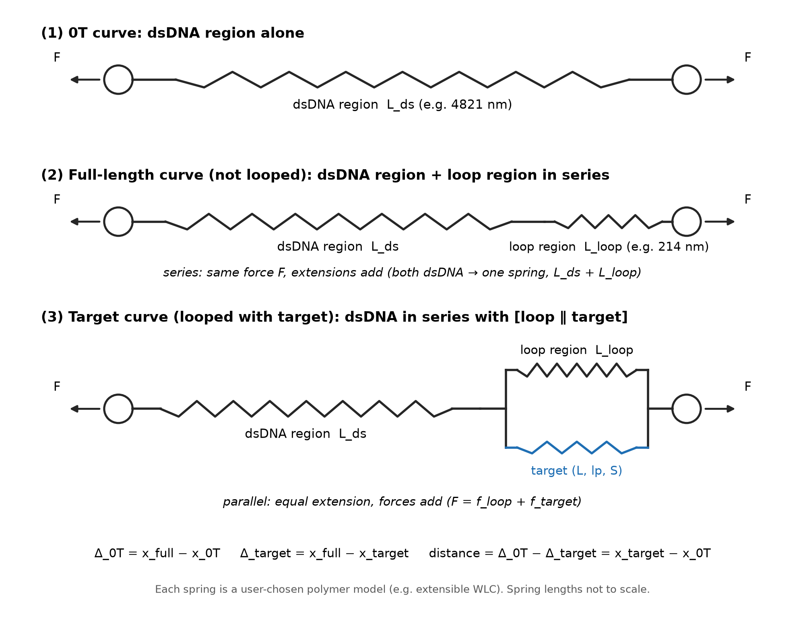

# DNA force-extension toolkit: model schematic

This folder holds design documentation for the DNA force-extension toolkit proposed in [issue #32](https://github.com/andyrward/Optical_Trap_Calibration/issues/32).

Figure 1 shows the three curves the toolkit computes, drawn as springs. The 0T curve is the dsDNA region alone. The full-length curve is the dsDNA region in series with the loop region. The Target curve is the dsDNA region in series with a block in which the loop and the target sit in parallel, so they share one extension and the force splits between them. Segments in series carry the same force and their extensions add. The delta extensions are Δ_0T = x_full − x_0T and Δ_target = x_full − x_target, and the distance estimate is Δ_0T − Δ_target = x_target − x_0T.

**Figure 1.** Spring schematic of the DNA force-extension toolkit models from issue #32: the 0T curve (dsDNA region alone), the full-length curve (dsDNA region in series with the loop), and the Target curve (dsDNA region in series with the loop and target in parallel), with the delta-extension and distance equations below. A vector version is in `DNA_FE_toolkit_model_schematic.svg`.
